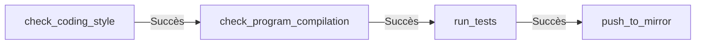

# 🍫 Chocolatine — Pipeline CI/CD & Contrôle Qualité Automatisé

**Chocolatine** est un workflow d'intégration continue et de livraison continue (CI/CD) implémenté via **GitHub Actions** (`.github/workflows/petitpain.yml`). Il automatise les contrôles stricts de qualité de code, de compilation sans avertissement, de couverture de tests et de réplication miroir pour les projets étudiants d'Epitech.

---

## 🔄 Les 4 Étapes du Pipeline

### 1. `check_coding_style`
- S'exécute dans le conteneur officiel `ghcr.io/epitech/coding-style-checker:latest`.
- Analyse récursivement l'ensemble des fichiers C et en-têtes du dépôt.
- Parse le fichier `coding-style-reports.log` généré et convertit chaque violation de norme en annotation d'erreur directe GitHub Actions (`::error file=...,line=...::...`).
- Bloque l'exécution des étapes ultérieures si au moins une infraction est constatée.

### 2. `check_program_compilation`
- S'exécute dans l'image de compilation `epitechcontent/epitest-docker:latest`.
- Exécute `make` avec une limite de temps stricte de 2 minutes.
- Valide la présence et les droits d'exécution du binaire cible spécifié dans la variable d'environnement `EXECUTABLES`.
- Lance `make clean` pour vérifier le nettoyage intermédiaire des fichiers objets.

### 3. `run_tests`
- Déclenche la suite de tests unitaires Criterion via la cible `make tests_run`.
- Timeout de 2 minutes pour prévenir toute boucle infinie dans les tests.

### 4. `push_to_mirror`
- En cas de validation intégrale des étapes précédentes, synchronise automatiquement la branche vers le dépôt miroir distant d'évaluation (`MIRROR_URL`) en utilisant une clé SSH privée (`SSH_PRIVATE_KEY`).

---

## ⚙️ Configuration Requise

Pour activer le miroir automatique sur votre propre fork, configurez les secrets du dépôt GitHub :
- `SSH_PRIVATE_KEY` : Clé privée SSH autorisée en écriture sur le dépôt cible de destination.
